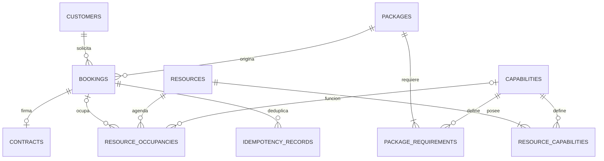

# Modelo implementado

Clientes separados del acceso administrativo; trabajadores y equipos como recursos
identificables. Capacidades y requisitos son relaciones normalizadas con PK compuesta,
sin listas redundantes en tablas. Una ocupación con booking representa una asignación;
sin booking representa un bloqueo. CHECK distingue esas dos formas válidas.

El snapshot JSONB de la reserva conserva precio, condiciones, duración y requisitos:
es un documento histórico deliberado, no la fuente editable del catálogo. Una entidad
de cotización separada se añadirá con negociación/versiones en CRM. No hay oportunidad
de venta ni cita de firma representada incorrectamente como evento.

Claves foráneas impiden referencias huérfanas; cantidades positivas y tiempos ordenados
se comprueban en BD. Exclusión GiST evita recursos simultáneos; unicidad booking/recurso
evita contar dos funciones. Índices por cliente, inicio, estado y recurso apoyan agenda.

`audit_logs` registra acción, entidad, actor administrativo y fecha. `outbox` conserva
operaciones pendientes con clave única, intentos, estado y próxima ejecución.
`idempotency_records` conserva hash de solicitud y resultado dentro de la misma transacción.

Primera migración explícita: `5e8d8dfa2f56`. No usa create_all en el arranque.
No ejecutar downgrade sobre datos reales sin respaldo y autorización: elimina tablas.
