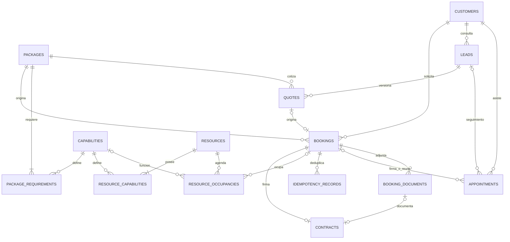

# Modelo implementado

Clientes separados del acceso administrativo; trabajadores y equipos como recursos
identificables. Capacidades y requisitos son relaciones normalizadas con PK compuesta,
sin listas redundantes en tablas. Una ocupación con booking representa una asignación;
sin booking representa un bloqueo. CHECK distingue esas dos formas válidas.

El snapshot JSONB de la reserva conserva precio, condiciones, duración y requisitos:
es un documento histórico deliberado, no la fuente editable del catálogo. Una entidad
de cotización separada conserva cada versión con unicidad por oportunidad/versión.
La oportunidad y la cita administrativa tienen tablas propias y no bloquean producción.

Claves foráneas impiden referencias huérfanas; cantidades positivas y tiempos ordenados
se comprueban en BD. Exclusión GiST evita recursos simultáneos; unicidad booking/recurso
evita contar dos funciones. Índices por cliente, inicio, estado y recurso apoyan agenda.

`audit_logs` registra acción, entidad, actor administrativo y fecha. `outbox` conserva
operaciones pendientes con clave única, intentos, estado y próxima ejecución.
`idempotency_records` conserva hash de solicitud y resultado dentro de la misma transacción.

Primera migración explícita: `5e8d8dfa2f56`. No usa create_all en el arranque.
No ejecutar downgrade sobre datos reales sin respaldo y autorización: elimina tablas.

Segunda migración aditiva: `3f152243a93e`. Añade contactos estructurados, `leads`,
`quotes`, `appointments`, `booking_documents` y relaciones opcionales sin modificar los
valores previos. Los documentos tienen UUID; las reservaciones conservan sus ID enteros
para no romper las referencias existentes. Contratos anteriores pueden vincularse a un
archivo sin cambiar referencia, fecha de firma, condiciones o estado de la reservación.

Los clientes anteriores no reciben fechas de registro inventadas: `created_at` queda
nulo. `last_activity_at` se completa al registrar nuevas actividades. `featured` es manual;
recurrencia y cantidad de contrataciones se calculan desde reservas confirmadas/completadas,
sin contadores redundantes. Las canceladas no cuentan.

Índices: reservas por inicio/estado/cliente; contactos por fecha de registro/actividad y
teléfono/correo normalizados; oportunidades por cliente, etapa y sus tres fechas;
cotizaciones por oportunidad/fecha y versión única; citas por inicio/relaciones;
documentos por reserva/fecha/grupo y versión única; contratos por fecha de firma.
Las búsquedas de texto usan ILIKE; no hay índice trigram ni motor externo. Evaluar su
necesidad con planes reales si el volumen crece. Paginación por offset: estable con
datos sin cambios; altas concurrentes pueden desplazar páginas.
