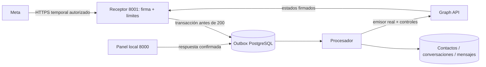

# WhatsApp Cloud API — preparación local, fase 4

## Estado al cierre del 20/10/2026

- Panel, receptor y worker: una instancia raíz de cada componente. Un túnel local
  existente; no se abrió otro. Petición sin firma al receptor: 401 esperado.
- Configuración local sin bloqueos declarados. Eso **no verifica** la credencial
  ante Meta. El último intento guardado con esa misma revisión de configuración
  presenta `http_401_meta_190`: revisión pendiente de la credencial privada.
- Se conservaron cinco operaciones fallidas y su historial. No había trabajos
  pendientes/sending/unknown en la consulta de cierre. No se reintentó ningún envío.
- El historial también contiene un mensaje con estado entregado; no se realizó una
  nueva prueba de entrega real durante este cierre.
- No se modificó ningún `.env`, token, secreto ni permiso.

### Diagnósticos en la interfaz

| Código | Interpretación presentada |
| --- | --- |
| `http_400` | Meta rechazó ese intento; falta causa detallada en el registro antiguo. |
| `send_policy_blocked` | Una validación bloqueó ese intento; no se puede reconstruir cuál a partir del código genérico. |
| `http_401_meta_190` | Posible credencial inválida, caducada o revocada; revisar configuración privada. |
| `http_429`, `http_5xx` | Fallo potencialmente temporal del proveedor en ese intento. No se reenvía. |
| `provider_result_unknown` | Verificar recepción antes de repetir; no equivale a fallo seguro. |

Cada mensaje conserva el código técnico en un desplegable. El total de errores
históricos está en **Estado de WhatsApp**, sin alerta global de avería.
Los faltantes efectivos de configuración sí se muestran por separado.

Para avisar de **revisión pendiente del último intento**, se exige que su revisión
de configuración coincida con la del panel y que pertenezca a la cuenta configurada.
Un intento posterior aceptado/enviado/entregado/leído sustituye ese aviso. Cambiar
la revisión evita presentar el fallo antiguo como diagnóstico de la nueva.
Esto no comprueba vigencia ni permisos remotamente, y no asegura que un error antiguo
esté resuelto. Los intentos anteriores sin revisión no generan ese aviso global.

Referencia para contrastar manualmente: [errores de Meta WhatsApp](https://developers.facebook.com/docs/whatsapp/cloud-api/support/error-codes/).
La consulta web de esta referencia y la guía Graph devolvió HTTP 429 durante el
cierre; no se afirma haber verificado su contenido actualizado. El aviso es
conservador, basado en la categoría OAuth y el código almacenado, no en una nueva
comprobación de credenciales.

## Historial de preparación

**Actualización del 19 de octubre:** el usuario confirmó recepción real. Se corrigió
la separación entre identidad entrante y destinatario de envío. Ver el
[diagnóstico y configuración de la corrección](whatsapp-routing-fix.md).
El estado inicial descrito a continuación corresponde a la entrega del 16 de octubre.

Implementación de recepción persistente, bandeja y adaptador real de Graph API. Las pruebas
usan PostgreSQL y HTTP simulado. **La conexión real con Jordy Studio Dev está pendiente**:
no se ha abierto un túnel, conectado una cuenta ni enviado mensajes desde esta implementación.
La prueba anterior hecha por el usuario en Meta no verifica este backend.

## Arranque local

Desde la carpeta del repositorio, en PowerShell:

```powershell
.\scripts\start-panel.ps1 -NoBrowser
# Otra terminal, receptor aislado (no abre un túnel):
.\scripts\start-whatsapp.ps1 -Mode receiver
# Otra terminal, procesamiento persistente (mantener envíos deshabilitados):
.\scripts\start-whatsapp.ps1 -Mode worker
# Comprobación local, sin mensajes:
.venv\Scripts\python.exe scripts\check_webhook_isolation.py
```

El panel sigue en http://127.0.0.1:8000; receptor en 127.0.0.1:8001.
Ctrl+C detiene cada proceso iniciado en su terminal. No son servicios permanentes.
El receptor no importa `jordy.main` ni monta el panel, archivos, login, docs o health.
El procesador no responde automáticamente: únicamente envía solicitudes manuales ya confirmadas.
Sin procesador, el webhook acepta y guarda la cola pero la bandeja no se actualiza todavía.
Reiniciar panel, receptor y procesador después de cambiar configuración.

## Configuración privada

Copiar **manualmente** `docs/whatsapp.env.example` a `.env.whatsapp`, sin sobrescribir `.env`.
La conexión PostgreSQL existente se reutiliza desde `.env`. No copiar credenciales a este documento.
Los archivos privados están ignorados por Git. No se han creado valores inventados para Meta.

1. Revocar o sustituir el Access Token expuesto antes de permitir cualquier envío.
   Confirmar que el nuevo token corresponde al número/cuenta de prueba de **Jordy Studio Dev**
   y tiene `whatsapp_business_messaging`. No conceder permisos ni conectar negocios nuevos.
2. Completar los Phone Number ID y WABA ID que ya existen. No confundir el ID con el teléfono.
3. Configurar App Secret de esta aplicación y un Verify Token aleatorio **distinto** del Access
   Token, de al menos 32 caracteres. El primero autentica POST; el segundo verifica la URL por GET.
4. Configurar `META_GRAPH_API_VERSION` con una versión actualmente admitida en la consola de Meta
   (`vNN.0`). Se exige explícitamente; la prueba usa `v99.0` ficticia exclusivamente en mocks.
5. Autorizar únicamente tu teléfono de prueba en `WHATSAPP_ALLOWED_RECIPIENTS`, como lista JSON
   de identificadores exactos, por ejemplo `[]` inicialmente. Usar el ID internacional recibido;
   no se adivinan prefijos mexicanos ni se fusionan números distintos.
6. Mantener `WHATSAPP_SEND_ENABLED=false` y `WHATSAPP_TOKEN_ROTATED=false` hasta completar
   sustitución y autorización. Después de autorizar envíos, ambas deben ser `true`.
7. Opcional: cargar `WHATSAPP_APPROVED_TEMPLATES` con `nombre:idioma` verificado como aprobado
   en esta cuenta. Solo se admiten plantillas sin parámetros/componentes dinámicos.
   No asumir que `hello_world:en_US` está disponible: comprobarlo en la cuenta de prueba.

La configuración en el panel muestra faltantes y conteos de cola, nunca los secretos.
La bandera de sustitución es una confirmación administrativa; no puede revocar ni comprobar
por sí sola el token anterior. Meta sigue siendo la autoridad sobre vigencia, permisos,
aprobación de plantillas y entrega. No se verifica remotamente nada al arrancar.

## Conectar Meta — solo después de autorización expresa

**Detenerse aquí antes de ejecutar el túnel.** La implementación y estas instrucciones no
autorizan exposición pública ni envío real. No utilizar el puerto 8000 para el túnel.

1. Con receptor y procesador activos, ejecutar la comprobación de aislamiento anterior.
2. Tras autorizar exposición temporal, preparar ngrok oficial y su cuenta local sin instalar
   un servicio. Revisar retención/inspección en su consola; un túnel transporta datos privados
   a un tercero. El script deshabilita la inspección local de solicitudes, no promete borrar
   registros que el proveedor mantenga en la nube.
3. Ejecutar únicamente tras esa autorización:

   ```powershell
   .\scripts\start-webhook-tunnel.ps1 -AuthorizeTemporaryExposure
   ```

   El destino está fijado a `http://127.0.0.1:8001`. El script comprueba primero rutas y métodos
   y no acepta cambiar el destino. No abre PostgreSQL ni modifica el router.
4. Copiar la URL HTTPS que muestre ngrok. En **Jordy Studio Dev**, abrir la configuración de
   WhatsApp/webhooks (la etiqueta de la consola puede variar) y establecer:
   - Callback URL: `https://TU-DOMINIO-TEMPORAL/webhooks/whatsapp` (sin barra final).
   - Verify token: el mismo valor privado de `META_WEBHOOK_VERIFY_TOKEN`.
5. Verificar y guardar. Suscribirse al campo **messages** del objeto WhatsApp Business Account;
   este campo incluye mensajes y estados. Comprobar que esta aplicación está suscrita a la WABA
   de prueba existente. La API oficial ofrece `/{WABA-ID}/subscribed_apps`; no se ejecuta ni se
   cambia la suscripción automáticamente desde este proyecto.
6. Enviar tú un texto desde tu teléfono autorizado al número temporal de Meta. En **Mensajes**,
   comprobar contacto, texto e historial. Refresca cada 5–10 segundos mientras está abierto.
7. Tras autorizar el nuevo token y destinatario, habilitar envíos y reiniciar los procesos.
   Elegir conversación → escribir → **Revisar y enviar** → verificar destinatario y contenido →
   **Confirmar envío por WhatsApp**. Comprobar recepción en el teléfono y callback `delivered`
   o `read` en la bandeja. `accepted` no demuestra entrega.
8. Registrar fecha, cuenta/IDs no secretos, resultado de recepción, respuesta y estado final.
   No adjuntar tokens, capturas de credenciales ni contenido privado de conversaciones.

Para cerrar: Ctrl+C en ngrok; comprobar en su consola que el endpoint está offline y que
la URL temporal ya no llega al receptor. Detener receptor/procesador con Ctrl+C y volver a
`WHATSAPP_SEND_ENABLED=false` si terminó la prueba. La aplicación local puede continuar abierta.
Meta puede reintentar eventos pendientes: conservar la base de datos y las claves de deduplicación.

## Arquitectura y persistencia



Módulo `backend/jordy/messaging`: `config` privada; `webhook` autenticación/normalización;
`service` identidad y reglas; `worker` transacciones/reintentos; `provider` contrato común y
adaptador WhatsApp; `api` administración autenticada. No se implementa Instagram ni IA.
`httpx`, ya usado por las pruebas del proyecto, pasa a dependencia de ejecución por sus
timeouts, transporte simulado y control de redirecciones; no se añade otro framework.

Migración aditiva `7b41c092a661`, posterior a `3f152243a93e`:

| Cambio | Función |
|---|---|
| `conversations` | Identidad única `(channel, account_id, external_contact)`, cliente opcional, responsable, estado y fechas. Una conversación persistente por identidad; un cliente puede tener varias identidades. |
| `messages` | Historial, dirección/tipo, texto permitido, ID externo único por canal/cuenta, UUID de solicitud y hash, estados y código de error. |
| `message_receipts` | Estados mínimos, incluso si llegan antes de almacenar la respuesta de Graph. Unicidad por cuenta/ID/estado/fecha. |
| `outbox.topic` | Discriminador `booking` para registros existentes; `whatsapp.inbound` y `whatsapp.send` para mensajería. El worker de calendario ignora estos últimos. |

El downgrade rechaza tablas o colas con historial de mensajes. Solo permite revertir un
esquema vacío como el creado por las pruebas; no ejecutar downgrades sobre datos operativos.

Identidad: se reutiliza teléfono normalizado exacto y único (incluido contacto legado), nunca
el nombre. Una coincidencia múltiple queda sin cliente y no crea otro. Si no hay coincidencias,
se crea un contacto mínimo no destacado. Un nombre de perfil es autodeclarado, no verificado.
La bandeja permite confirmar/reasignar el vínculo con una ficha existente, con auditoría.
No se fusionan ni borran fichas. Las oportunidades se consultan por cliente; no se inventa una
relación comercial al recibir un mensaje. Ni reservas, ni contratos, ni cotizaciones automáticos.
`automated` queda reservado en el diseño: la API y el CHECK lo rechazan; solo `human` y `closed`.

## Endpoints

Solo en el receptor aislado:

- `GET /webhooks/whatsapp`: challenge con modo y Verify Token correctos.
- `POST /webhooks/whatsapp`: firma HMAC-SHA256 sobre bytes originales, comparación constante,
  cuenta/número configurados, validación y límite 256 KiB. 200 solo después del commit;
  401 firma inválida; 400 estructura inválida; 413 exceso; 503 configuración/almacenamiento.

Solo en el panel autenticado (`/api/messaging`):

- `GET /config`: estado redactado y conteos de cola.
- `GET /conversations?page=1&page_size=20&q=...`: búsqueda y paginación.
- `GET /conversations/{id}`: detalle, cliente y últimas 20 oportunidades relacionadas.
- `GET /conversations/{id}/messages?before={message_id}&limit=50`: historial cronológico con cursor.
- `PATCH /conversations/{id}`: atención `human/closed` y responsable opcional.
- `POST /conversations/{id}/customer`: vínculo con confirmación expresa de identidad.
- `POST /conversations/{id}/reply`: UUID idempotente, confirmación y texto o plantilla permitida;
  devuelve 202 al **encolar**, no al entregar.

## Seguridad, reintentos y límites

La entrada pública no sirve recursos privados ni tiene rutas de login. No se registran cuerpos
ni errores íntegros del proveedor. El arranque propuesto desactiva access logs y proxy headers:
el Verify Token va en query GET y no debe aparecer en logs. Secrets se cargan en backend;
la bandeja no los recibe. Toda mutación administrativa conserva autenticación y Origin.
Graph usa host HTTPS fijo, Bearer en cabecera, versión/ID validados, timeout 20 s (conexión 5 s),
respuesta acotada y sin redirects ni proxies heredados. Los códigos de error son genéricos,
sin copiar el texto del proveedor que pudiera contener datos privados.

Reintentos de entrada: clave externa única en outbox, restricción única en mensajes y bloqueo
transaccional de identidad/contacto. Persistencia de contacto/mensaje/actividad atómica.
Se reintenta con espera creciente hasta 10 fallos; luego requiere diagnóstico administrativo.
El cuerpo normalizado se conserva en trabajos fallidos para recuperarlos; al procesarlo se
limpia del outbox y permanece solo en el historial. Avisos desconocidos guardan metadatos mínimos.

Envíos: validación al encolar **y** al despachar; habilitación separada, token sustituido,
destinatario permitido, cuenta/número coincidentes, atención humana y ventana de 24 horas desde
el último texto entrante reconocido. Avisos de sistema, tipos desconocidos y multimedia
solo guardan metadatos y no abren la ventana local en esta fase. Fuera de ventana, solo plantilla explícitamente aprobada. UUID de
solicitud + hash evita doble clic/reintento HTTP con otro contenido. La petición al proveedor
se hace después de guardar `submitting/sending` en otra transacción, sin locks durante la red.

No hay reenvío automático tras errores HTTP (incluido 429), timeout, 5xx o reinicio durante
envío. Un resultado incierto pasa a `unknown`; confirmar manualmente antes de volver a enviar.
Con ID externo conocido, los callbacks se reconcilian incluso si llegaron antes, y `delivered`
o `read` no retroceden por callbacks tardíos. Sin ID externo tras perder la respuesta, no se
adivina la correspondencia: el recibo queda guardado y el envío requiere revisión. No se ofrece
garantía de exactamente una entrega en la red ni una clave de idempotencia ficticia a Meta.

Limitaciones: sin descargas multimedia, búsqueda global en cuerpos, contador de no leídos,
IA, Instagram, grupos, llamadas, edición/borrado externo, plantillas con parámetros o campañas.
Se guardan IDs opacos para futuras identidades; esta fase solo envía a IDs telefónicos numéricos
autorizados. No resuelve automáticamente cambios de número, números compartidos o nombres de
usuario nuevos de Meta. Coincidencia exacta de teléfono no equivale a identidad legal verificada.
La aprobación de plantillas configurada debe mantenerse manualmente; Meta puede rechazarla.
El receptor comparte acceso a PostgreSQL local con el monolito; un rol DB de privilegios mínimos,
rate limiting del borde, cuotas y supervisión son pendientes antes de producción. La interfaz
muestra fallos, pero no incluye un botón de reintento de envíos inciertos.

Privacidad pendiente de decisión del estudio: consentimiento y aviso de privacidad, plazo
de retención de texto/identidades/recibos/colas/backups, procedimiento de acceso y eliminación,
protección del disco/respaldos y acceso por usuario. No se borran datos automáticamente.
No activar producción hasta acordarlo; las pruebas deben usar únicamente el teléfono autorizado.

## Fuentes oficiales consultadas

- [Colección oficial de Meta: Cloud API, envío, permisos y suscripción WABA](https://www.postman.com/meta/whatsapp-business-platform/documentation/wlk6lh4/whatsapp-cloud-api?entity=request-13382743-2ec98f2a-93d4-465b-a52e-2eb0ee21cf11).
- [Guía oficial de webhooks Meta](https://developers.facebook.com/docs/graph-api/webhooks/getting-started/).
- [Documentación oficial de mensajes de WhatsApp](https://developers.facebook.com/documentation/business-messaging/whatsapp/messages/send-messages).
- [CLI oficial ngrok](https://ngrok.com/docs/gateway/agent/cli).

Consulta del 16 de octubre de 2026: se pudo leer la colección oficial en Postman y la CLI
ngrok; varias páginas de developers.facebook.com devolvieron límites/errores de acceso.
No se dedujo una versión “más reciente” de Graph a partir de fuentes secundarias: se exige
la versión admitida mostrada en la cuenta. Revisar compatibilidad en la prueba real autorizada.

## Tres conceptos sencillos

Un **webhook** es una llamada que Meta hace a nuestra dirección cuando llega un mensaje,
en lugar de que el estudio pregunte constantemente si hay novedades.

La **firma** es un sello calculado con el App Secret y los bytes exactos del aviso. Recalculamos
ese sello y lo comparamos: si alguien cambia el cuerpo o no conoce el secreto, se rechaza.
El Verify Token solo sirve para demostrar a Meta que controlamos la dirección al configurarla.

La **deduplicación** utiliza el ID del mensaje como folio único en PostgreSQL. Aunque Meta lo
entregue varias veces o haya dos procesadores, las restricciones y transacciones permiten
crear un solo registro. Esto no significa que podamos reenviar a ciegas una respuesta perdida.
